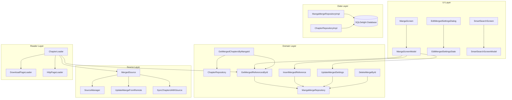

# TachiyomiSY Manga Merge — Reverse Engineering & Porting Audit

This document provides a comprehensive analysis of the Manga Merge feature in TachiyomiSY, intended as a blueprint for porting it to Mihon Enhanced.

## 1. Architecture Overview

TachiyomiSY implements Manga Merge using a **Proxy Source** and **Relational Reference** pattern.

- **The Parent Manga**: A "dummy" manga entry is created in the database with `source = -1` (`MERGED_SOURCE_ID`). This manga acts as the container for all merged children.
- **The Child Mangas**: Regular manga entries from various sources. They remain independent in the database but are linked to the parent via the `merged` table.
- **The Proxy Source (`MergedSource`)**: A specialized `HttpSource` implementation that doesn't hit the network directly for its own data. Instead, it delegates details fetching and chapter syncing to the child sources.
- **Aggregated Chapter Logic**: Chapters are fetched from all child mangas, combined, and then deduped/sorted based on user preferences stored in the merge references.

## 2. Dependency Graph

## 3. Database Schema (`merged.sq`)

The core of the feature is the `merged` table:

| Column | Type | Description |
| :--- | :--- | :--- |
| `_id` | INTEGER | Primary Key |
| `merge_id` | INTEGER | Foreign Key -> `mangas._id` (The Parent) |
| `manga_id` | INTEGER | Foreign Key -> `mangas._id` (The Child) |
| `info_manga` | BOOLEAN | If true, this child provides the metadata (title, cover, etc.) |
| `get_chapter_updates`| BOOLEAN | Whether to fetch new chapters for this child |
| `download_chapters` | BOOLEAN | Whether to auto-download new chapters from this child |
| `chapter_sort_mode` | INTEGER | Sorting/Dedupe strategy (set on parent reference) |
| `chapter_priority` | INTEGER | Priority for deduping (lower = higher priority) |
| `merge_url` | TEXT | Stable URL for the parent |
| `manga_url` | TEXT | Stable URL for the child |
| `manga_source` | INTEGER | Source ID for the child |

## 4. Key Logic Flows

### 4.1. Chapter Loading & Interleaving
1. `GetMergedChaptersByMangaId` is called.
2. It fetches all chapters for all child `manga_id`s linked to the `merge_id`.
3. It applies `dedupeChapterList` based on the parent's `chapterSortMode`:
    - **No Dedupe**: Show everything.
    - **Priority**: Use `chapterPriority` to pick one chapter when multiple sources have the same chapter number.
    - **Most Chapters**: Pick the source with the highest total count.
    - **Highest Number**: Pick the source with the highest chapter number.

### 4.2. Update Checker
1. When a merged manga is updated, `MergedSource.fetchChaptersAndSync` is triggered.
2. It iterates through all children where `getChapterUpdates` is true.
3. It performs a standard chapter sync for each child.
4. It triggers auto-downloads for children where `downloadChapters` is true.

### 4.3. Reader Integration
1. `ChapterLoader` detects `source is MergedSource`.
2. It uses `mergedReferences` to find which child the current chapter belongs to.
3. It identifies the correct `Source` and `Manga` (child) to create the appropriate `PageLoader`.

## 5. Porting Audit (Mihon Enhanced)

### [SAFE TO COPY]
- `tachiyomi/domain/manga/model/MergedMangaReference.kt`
- `tachiyomi/domain/manga/model/MergeMangaSettingsUpdate.kt`
- `tachiyomi/domain/manga/repository/MangaMergeRepository.kt`
- `tachiyomi/data/manga/MangaMergeRepositoryImpl.kt`
- `tachiyomi/data/manga/MergedMangaMapper.kt`
- `tachiyomi/domain/manga/interactor/GetMergedReferencesById.kt`
- `tachiyomi/domain/manga/interactor/InsertMergedReference.kt`
- `tachiyomi/domain/manga/interactor/UpdateMergedSettings.kt`
- `tachiyomi/domain/manga/interactor/DeleteByMergeId.kt`
- `tachiyomi/domain/manga/interactor/DeleteMergeById.kt`
- `merged.sq` (Database definition)

### [NEEDS ADAPTER]
- `MergedSource.kt`: Update imports and ensure compatibility with Mihon's `UpdateMangaFromRemote`.
- `GetMergedChaptersByMangaId.kt`: Adapt to Mihon's `ChapterRepository` and `Chapter` model.
- `BackupMergedMangaReference.kt`: Ensure ProtoNumber alignment if Mihon has existing extensions.
- `EditMergedSettingsDialog.kt`: Port UI strings and handle Material 3 theme compatibility.

### [NEEDS REWRITE / HOOKS]
- `MangaScreenModel.kt`: Carefully integrate `updateMergeSettings` and `deleteMerge` into the existing ViewModel.
- `MangaScreen.kt`: Add "Merge" and "Merged Settings" buttons to Mihon's Compose UI.
- `ChapterLoader.kt`: Surgical insertion of merged source handling logic.
- `BackupManager.kt` / `BackupRestorer.kt`: Integration for serializing the `merged` table.

## 6. Compatibility & Risks

1. **Package Names**: Mihon uses `mihon.*` for new code. Ported logic should be moved to `eu.kanade.tachiyomi.ui.mod.merge` or similar as per `AGENTS.md`.
2. **Resource IDs**: `SYMR` and `SY` specific strings must be added to Mihon's `strings.xml`.
3. **Database Consistency**: Merging relies on `mangas._id`. If a manga is deleted and re-added with a different ID, references might break unless the restorer uses URLs/Sources (which TachiyomiSY does).
4. **Download Manager**: `DownloadManager` in Mihon might have slight API differences regarding multi-source downloads for a single entry.

## 7. Migration Plan (Copy Order)

1. **Phase 1: Data Models & Persistence**
    - `merged.sq`, `MergedMangaReference`, `MangaMergeRepository`.
2. **Phase 2: Domain Interactors**
    - `GetMergedReferencesById`, `InsertMergedReference`, `UpdateMergedSettings`.
3. **Phase 3: Source Proxy**
    - `MergedSource`, register in `SourceManager`.
4. **Phase 4: Aggregation Logic**
    - `getMergedChaptersByMangaId` in `chapters.sq`, `GetMergedChaptersByMangaId`.
5. **Phase 5: UI & ViewModel Hooks**
    - `MangaScreenModel` extensions, `MangaScreen` UI additions, `EditMergedSettingsDialog`.
6. **Phase 6: Infrastructure Hooks**
    - Reader (`ChapterLoader`), Backup/Restore, Sync/Update Checker.
7. **Phase 7: Smart Search**
    - Port `SmartSearchScreen` to facilitate finding merge targets.
